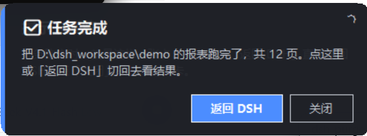

# 桌面提示卡：任务跑完 / 有待选项时，在屏幕角落弹原生卡片

DSH 跑一轮任务往往要几十秒到几十分钟。你切出去打游戏、看视频时，既不知道这一轮
什么时候结束，也不知道 DSH 是不是正等你选方案，只能反复切窗口回来看。

这个插件在 **一轮跑完** 或 **有选项 / 审批等你处理** 时，直接在屏幕角落弹一张原生
置顶卡片（不是网页里的 toast —— 全屏游戏里根本看不见），点一下就回到 DSH。

## 特点

- **原生窗口**：PowerShell 7 + WinForms 常驻助手，`TopMost` 盖在全屏游戏、最大化浏览器之上
- **不抢焦点**：带 `WS_EX_NOACTIVATE`，弹卡时你在游戏里的操作不会被打断
- **两个按钮**：「返回 DSH」把 DSH 窗口切到前台；「关闭」只收掉卡片
- **点卡片也算返回**：标题、正文、左侧色条都能点
- **全部可配**：背景色、强调色、整卡不透明度、九宫格弹出位置、边距、宽度、停留秒数、
  提示音（9 种，含自定义 wav）、打开设置的热键
- **不刷屏**：同一 key 3 秒内只弹一次；子代理结束不弹；可设「DSH 已在前台时不弹」
- **常驻预热**：插件加载后 1.2 秒拉起助手，之后 30 秒心跳保活，热键随时可用

## 什么时候弹

| 事件 | 卡片标题 |
| --- | --- |
| 一轮正常跑完 | ✅ 任务完成 |
| 这一轮出错 / 被拦截 | ⚠ 这一轮没跑通 |
| `ask_user_question` 待作答 | ❓ 等你选一下 |
| 工具审批待放行 | 🔐 等你授权 |

## 打开设置

- 热键：**Ctrl+Alt+B**（可在设置里换成 Ctrl+Alt+A / Ctrl+Alt+Shift+A / Ctrl+Alt+C /
  Ctrl+Alt+F9 / Ctrl+Alt+F10；候选链会跳过被别的软件占用的组合）
- 卡片右上角齿轮 ⚙
- 兜底：双击插件目录里的 `open-settings.cmd`

配置存在 `%USERPROFILE%\.dsh\task-alert\settings.json`，改完即时生效，不用重启 DSH。

## 已知边界

- **仅 Windows**：置顶、抢前台、全局热键都依赖 user32。
- 独占全屏（不是无边框全屏）的游戏，Windows 的 TopMost 也可能压不住，建议改成无边框窗口。
- 助手首次拉起约 1~2 秒（PowerShell 启动 + Add-Type 编译），之后常驻复用。

详细说明见 [docs/DETAIL.md](docs/DETAIL.md)。

## 许可

MIT
